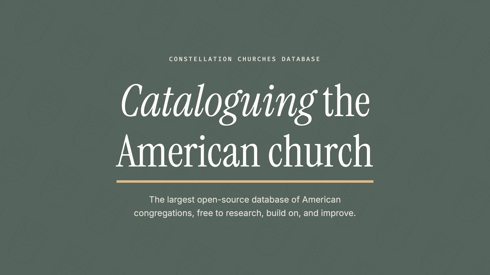

  

# Constellation Churches Database

> [!WARNING]
> Under active, heavy development. Cleanup of non-church entities and deduplication are still
> pending.

> [!IMPORTANT]
> Non-commercial use only.

Constellation Churches Database is the largest open-source database of US churches, built to help
people get out of unhealthy churches and into great ones.

The published set holds 229,954 records, with active work to get as close as
possible to the country's roughly 450,000 churches. Records are sourced from government records,
denominational listings, and mapping datasets, assembled with a custom pipeline, and published
only when two different kinds of source vouch that the church exists.

Up to 100,000 records will carry data extracted to our custom [90-field extraction schema](https://www.constellation.church/data), suitable for building search applications or filtering the data for research.

This database was assembled over hundreds of hours of human work at a five-figure cost. Agentic
development made a monumental amount of that work possible, but it was built with blood, sweat,
and tears.

## Church IDs

Every church has a Constellation Church ID: nine characters, the last two of them check digits,
always starting with a letter. Its official form is `https://constellation.church/{id}`.

IDs are immutable, favour no location or denomination, and are designed to survive congregations
splitting and merging. Keep them, and support the retired IDs file: `retired-identifiers.json`
holds every ID that was merged into another church or split into several, with the churches it
leads to now. If you hold an old ID, look it up there.

## Using this data

Poke around. Everything here is meant to be opened, read, and built on.

- **Browse by place.** `data/` holds one JSON file per church, filed as
  `data/{state}/{zip3}/{id}.json` (`data/ca/921/` is the city of San Diego). A church with no
  usable ZIP is in `data/{state}/no-zip/`, and one with no state in `data/unknown/`.
- **Don't trust the path.** A church whose address is corrected moves to another folder, so
  **cite and join on the identifier, never the path**.
- **Read one church.** Each file has the church's ID, names, address, coordinates, website,
  denominational listing URL, its visible external identifiers (EIN, directory ids that have a
  page, website and social pages) and its public advisories. `name` is spelled exactly as the
  church's source record spells it (`POLO COMMUNITY CHURCH INC`); `displayName` is ours, the
  name we publish it under (`Polo Community Church`), and changes when our naming rules do.
- **Grab it all at once.** `churches.parquet` / `churches.csv` are the same churches in one
  file each, built from the JSON, with `retired-identifiers.parquet` / `.csv` beside them.
  They are attached to the GitHub release of the same date and to `latest`, not committed.
  Identifiers and ZIP codes are text; do not let a spreadsheet convert them.
- **Cite a date.** Each release is the commit tagged with its date, so a paper can point at
  exactly the data it used.
- **Tell us what's wrong.** Data corrections, thoughts, and offers to help grow the database all
  go in [Discussions](https://github.com/hotchkissmade/churches/discussions).

## Licence

The identifiers and `retired-identifiers.*` are **CC0**: use them without restriction, in your own
systems. Everything else is CC BY-NC 4.0.

_Please note this is an **attribution required** licence:_ credit Constellation Churches Database
and link to https://constellation.church.

The IRS Business Master File is public domain. Where a church has a map match, its coordinates
come from [Overture Maps Foundation](https://overturemaps.org) data (CDLA Permissive 2.0).

## Acknowledgments

Thank you to my dear friend Brian Smith for sitting down with me at a Starbucks, looking at my
printed spreadsheets of churches and their websites, and believing in me from the very inception
of this project.

## This release

Last updated with release 2026-10-27.

| | |
| --- | ---: |
| Churches | 229,954 |
| Retired identifiers | 1,514 |
